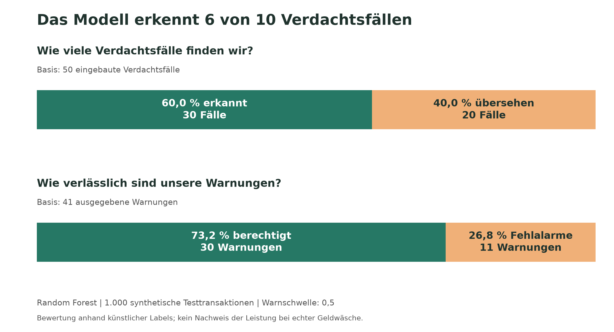

# Geldwäscheanalyse mit Machine Learning

Dieser Prototyp bewertet synthetische Finanztransaktionen mithilfe
eines Random-Forest-Modells. Eine REST-API nimmt dabei einzelne Transaktionen
entgegen und gibt einen Modellwert sowie ein Warnsignal zurück.
Ein Simulator sendet Transaktionen fortlaufend an die API.

Das Projekt demonstriert die technische Umsetzung und Bewertung eines
vereinfachten Systems zur Erkennung künstlicher Verdachtsmuster.
Es ist nicht für den produktiven Einsatz vorgesehen. Eine Warnung
ist noch kein Nachweis von Geldwäsche.

## Daten und Modell

Der Datensatz enthält 5.000 selbst erzeugte Transaktionen.
Davon sind 250 Transaktionen (5 %) als Verdachtsfälle
gekennzeichnet. Dieser Anteil ist eine Simulationsannahme.

Eingebaute Muster:
- Höhere Beträge an überwiegend neue Empfänger.
- Kleinere bis mittlere Beträge mit erhöhtem fiktivem Länderrisiko
  und überwiegend neuen Empfängern.
- Legitime Gegenbeispiele mit hohen Beträgen oder erhöhtem
  fiktivem Länderrisiko.

Das Modell verwendet drei Merkmale:
- `amount`: Transaktionsbetrag in Euro.
- `new_recipient`: Neuer Empfänger, codiert als 0 oder 1.
- `country_risk`: Fiktiver Länderrisikowert zwischen 0 und 1.

Empfängermerkmal und Länderrisiko werden künstlich erzeugt.
Sie werden nicht aus tatsächlichen Kontoverläufen oder realen
Länderlisten abgeleitet. Kontokennungen und Zeitstempel werden
nicht als Modellmerkmale verwendet.

Die Zielvariable `is_suspicious` kennzeichnet die simulierten
Verdachtsfälle und wird nicht als Eingabemerkmal verwendet.

Die Daten werden zufällig und stratifiziert aufgeteilt:
- 4.000 Transaktionen für das Training.
- 1.000 Transaktionen für den Test.
- Beide Teilmengen enthalten 5 % Verdachtsfälle.

Modelleinstellungen:
- 100 Entscheidungsbäume.
- Maximale Baumtiefe: 6.
- Mindestens 5 Trainingsbeispiele je Blatt.
- Zufallsstartwert: 42.
- Warnschwelle: 0,5.

Die Testdaten wurden nicht zur Anpassung der Modelleinstellungen
oder der Warnschwelle verwendet.

## Projektdateien

| Datei | Aufgabe |
|---|---|
| `generate_data.py` | Ausgangsdaten erzeugen |
| `add_anomalies.py` | Verdachtsfälle und Gegenbeispiele einbauen |
| `train_model.py` | Modell trainieren, bewerten und speichern |
| `plot_results.py` | Ergebnisgrafik erstellen |
| `api.py` | REST-API mit Eingabeprüfung und Protokollierung |
| `simulate_stream.py` | Transaktionsstrom simulieren und API prüfen |
| `requirements.txt` | Verwendete Paketversionen |

Die Programme erzeugen folgende Ordner:
- `data`: Synthetische Datensätze.
- `models`: Gespeichertes Modell mit Merkmalen und Warnschwelle.
- `results`: Kennzahlen, Vorhersagen, Grafiken und Stream-Ergebnisse.
- `logs`: API-Protokoll.

## Installation

Das Projekt wurde unter Windows mit Python 3.14.0 ausgeführt.
Die folgenden Befehle sind für PowerShell vorgesehen und werden
im Projektordner ausgeführt.

Virtuelle Umgebung erstellen:

```powershell
python -m venv .venv
```

Pakete installieren:

```powershell
.\.venv\Scripts\python.exe -m pip install -r requirements.txt
```

Die folgenden Befehle verwenden Python direkt aus dieser Umgebung.
Eine Aktivierung der Umgebung ist deshalb nicht erforderlich.

## Daten erzeugen und Modell trainieren

Die Programme in dieser Reihenfolge ausführen:

```powershell
.\.venv\Scripts\python.exe generate_data.py
.\.venv\Scripts\python.exe add_anomalies.py
.\.venv\Scripts\python.exe train_model.py
.\.venv\Scripts\python.exe plot_results.py
```

Die Skripte verwenden feste Zufallsstartwerte. Bei gleicher
Softwareumgebung lassen sich die Daten und Modellresultate
nachvollziehen. Erneutes Ausführen überschreibt die jeweiligen
generierten Dateien.

## API starten

Im Terminal ausführen:

```powershell
.\.venv\Scripts\python.exe -m uvicorn api:app --host 127.0.0.1 --port 8000
```

Der Server bleibt in diesem Terminl aktiv.
Mit Strg + C kann er beendet werden.

Interaktive Dokumentation:
http://127.0.0.1:8000/docs

Erreichbarkeitscheck:
http://127.0.0.1:8000/health

Die API läuft lokal auf dem eigenen Computer.

## Eine Transaktion bewerten

In der interaktiven Dokumentation `POST /predict` öffnen,
`Try it out` auswählen und beispielsweise diese Anfrage senden:

```json
{
  "transaction_id": "DEMO002",
  "amount": 8000,
  "new_recipient": 1,
  "country_risk": 0.8
}
```

Die Antwort enthält:
- `transaction_id`: Kennung der Transaktion.
- `model_score`: Modellwert zwischen 0 und 1.
- `threshold`: Warnschwelle.
- `alert`: Warnsignal, wenn der Modellwert die Schwelle erreicht
  oder überschreitet.

Der Modellwert ist eine nicht kalibrierte Wahrscheinlichkeitsschätzung
für die künstlichen Labels. Er beschreibt keine nachgewiesene
Wahrscheinlichkeit tatsächlicher Geldwäsche.

Die API prüft unter anderem:
- Positiver, endlicher Betrag.
- `new_recipient` als ganze Zahl 0 oder 1.
- Endliches Länderrisiko zwischen 0 und 1.
- Vorhandensein der Pflichtfelder.
- Keine zusätzlichen Eingabefelder.

## Transaktionsstrom simulieren

Während die API läuft, in einem zweiten Terminal ausführen:

```powershell
.\.venv\Scripts\python.exe simulate_stream.py
```

Der Simulator sendet die 1.000 Testtransaktionen in zeitlicher
Reihenfolge einzeln an die API. Zwischen den Anfragen liegen
jeweils 0,1 Sekunden Pause, zusätzlich zur Verarbeitungszeit.
Die ursprünglichen Zeitabstände werden nicht nachgebildet.

Labels und gespeicherte Offline-Vorhersagen werden nicht an die
API gesendet. Die Offline-Vorhersagen dienen lokal dem Vergleich
mit den API-Antworten.

Ergebnisdateien:
- `results/stream_results.csv`: Einzelne Antworten und Fehler.
- `results/stream_summary.csv`: Zusammengefasste Kennzahlen.

## Ergebnisse der Modellbewertung

Ergebnisse auf 1.000 Testtransaktionen, darunter 50 Verdachtsfälle:

| Kennzahl | Immer legitim | Random Forest |
|---|---:|---:|
| Accuracy | 95,0 % | 96,9 % |
| Precision für Verdachtsfälle | 0,0 %* | 73,2 % |
| Recall für Verdachtsfälle | 0,0 % | 60,0 % |
| F1 für Verdachtsfälle | 0,000 | 0,659 |

*Die Referenz erzeugt keine Warnungen. Ihre Precision ist daher
mathematisch nicht definiert und wird im Code mit `zero_division=0`
als 0 ausgegeben.

Fallzahlen des Random Forest:
- 939 richtig als legitim eingestuft.
- 11 Fehlalarme.
- 20 übersehene Verdachtsfälle.
- 30 erkannte Verdachtsfälle.



## Technische Tests

| Test | Beobachtetes Ergebnis |
|---|---|
| 250 Euro, bekannter Empfänger, Risiko 0.1 | Status 200, Modellwert etwa 0.00072, keine Warnung |
| 8.000 Euro, neuer Empfänger, Risiko 0.8 | Status 200, Modellwert etwa 0.847, Warnung |
| Negativer Betrag von -100 Euro | Status 422, Eingabe zurückgewiesen |

Im lokalen Stream-Test am 22.09.2026:
- 1.000 Anfragen gesendet und erfolgreich bewertet.
- Keine erfassten technischen Fehler.
- 41 Warnungen.
- Keine Abweichungen der Modellwerte und Warnentscheidungen
  gegenüber dem Offline-Test.
- Mittlere Antwortzeit: 41,88 ms.
- 95 Perzentil der Antwortzeit: 55,27 ms.

Die Antwortzeit wird im sendenden Programm gemessen und umfasst
die lokale HTTP-Anfrage bis zur Verarbeitung der Antwort.
Die künstliche Pause zwischen Anfragen ist nicht enthalten.
Laufzeiten hängen von Hardware und Betriebsbedingungen ab.

## Überwachung

Die API protokolliert in `logs/api.log`:
- Anfragepfad, HTTP-Methode und Statuscode.
- Serverseitige Bearbeitungsdauer.
- Transaktionskennung, Modellwert und Warnsignal bei Bewertungen.
- Unerwartete Verarbeitungsfehler.

Der Endpunkt `/health` dient als einfachee Erreichbarkeitsprüfung.
Der Simulator erfasst technische Fehler sowie Antwortzeiten und
vergleicht die Ergebnisse mit den Offline-Vorhersagen.

Eine automatische Überwachung von Datenverschiebungen oder
nachlassender Modellqualität ist nicht implementiert.

## Grenzen und Weiterentwicklung

- Daten und Labels beruhen auf selbst festgelegten Annahmen.
  Die Ergebnisse sind nicht auf echte Bankdaten übertragbar,
  ohne dies vorher gesondert zu prüfen.
- Das Modell übersieht im Test 40 % der eingebauten Verdachtsfälle.
- Kontobeziehungen und zeitliche Transaktionsketten werden
  nicht ausgewertet.
- Der Datenstrom wird durch aufeinanderfolgende REST-Anfragen
  simuliert. Ein verteilter Stream-Processing-Dienst mit
  Warteschlange ist nicht umgesetzt.
- Der technische Test verwendet die bereits bewerteten Testdaten.
  Er ist keine weitere unabhängige Prüfung der Modellqualität.
- Gleichzeitige hohe Last, Ausfallsicherheit und garantierte
  Echtzeitfristen wurden nicht untersucht.
- Authentifizierung und eine produktive Betriebsumgebung
  sind nicht eingerichtet.
- Das Modell lernt im Betrieb nicht selbstständig weiter.

Mögliche Erweiterungen sind realistischere Daten, aus vergangenen
Transaktionen abgeleitete Merkmale, eine Kalibrierung der
Wahrscheinlichkeitsschätzungen und die Überwachung der Modellqualität.
Modell- und Schwellenwertauswahl müssten dafür auf separaten
Validierungsdaten erfolgen.

Neue Datenquellen benötigen eine Abbildung auf das API-Schema.
Bei unveränderten Merkmalen kann ein neu trainiertes Modell durch
Austausch der Modelldatei und Neustart der API bereitgestellt werden.
Änderungen der Merkmale erfordern abgestimmte Anpassungen an
Training, Eingabeschema und Datenquelle.
